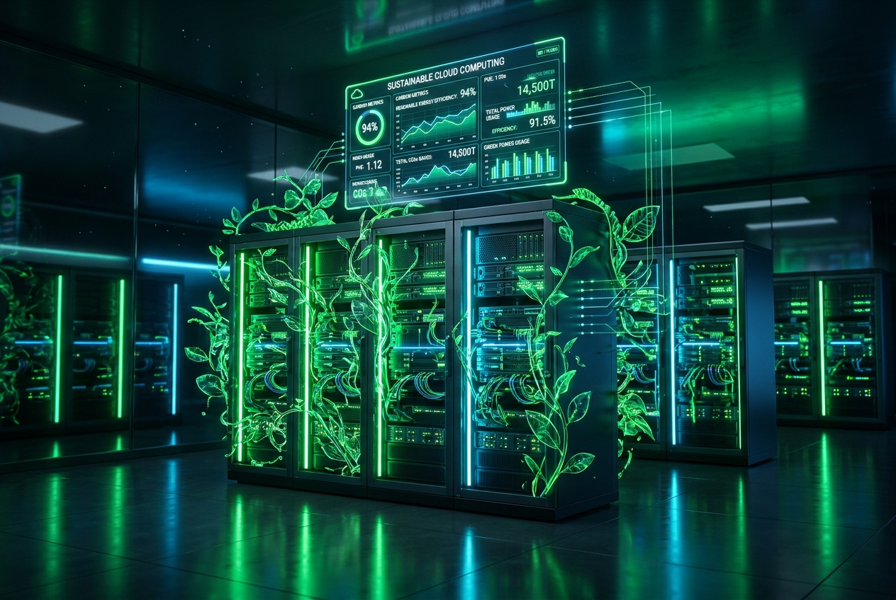
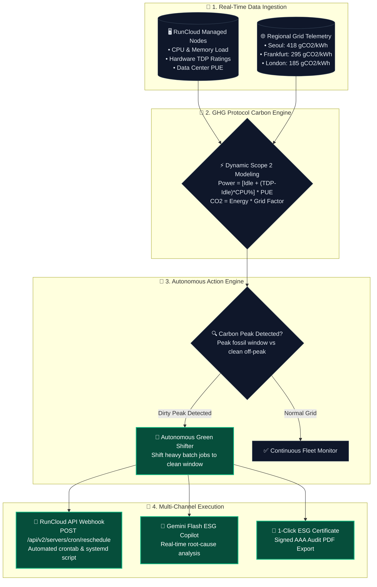

# 🌿 GreenOps AI — Autonomous Cloud Carbon Optimizer & ESG Action Engine

> **Built for the KULN Global Virtual Hackathon (KUK 2026)**  
> *Theme: ESG Automation — "Data to Action"*  
> *Official Sponsors: RunCloud, TechTamu, EzyEvents*

<p align="center">
  
</p>

[](https://nextjs.org/)
[](https://react.dev/)
[](https://tailwindcss.com/)
[](https://aistudio.google.com/)
[](https://runcloud.io/)
[](#-standardized-ghg-protocol-mathematical-model)

---

## 📌 Executive Summary

Data centers and global cloud workloads consume **~2% of global electricity**—a footprint expanding exponentially with AI model training and background web services. While modern enterprises pledge adherence to ESG (Environmental, Social, Governance) goals, cloud engineers and CTOs remain blind to their **real-time Digital Scope 2 and Scope 3 carbon emissions**.

**GreenOps AI** bridges the gap from raw telemetry to autonomous execution. Directly integrated with **RunCloud** managed server clusters across **Seoul, Frankfurt, Virginia, and London**, GreenOps AI synchronizes real-time power grid carbon intensity with live server CPU loads. 

It does not merely display dashboards—it delivers **"Data to Action"**:
1. **Autonomous Green Shifter:** Automatically reschedules carbon-intensive cron jobs (DB snapshots, AI embeddings, crawlers) from fossil-heavy peak grid hours to clean renewable windows.
2. **RunCloud Webhook Dispatcher:** Triggers dynamic systemd quota throttling and multi-region snapshot migrations via authenticated API payloads.
3. **Google Gemini ESG Copilot:** Real-time conversational AI providing root-cause emission diagnostics and verifiable audit explanations with live server context.
4. **1-Click Official ESG Audit Certificate:** Instant vector-grade PDF export compliant with **GHG Protocol Corporate Standards** and the **EU Corporate Sustainability Due Diligence Directive (CSDDD)**.

---

## ⚡ The "Data to Action" Pipeline



---

## 📐 Standardized GHG Protocol Mathematical Model

GreenOps AI adheres to the **GHG Protocol Scope 2 Guidance (Location-Based and Market-Based Methods)**:

### 1. Dynamic Server Power Draw (Watts):
$$\text{Power (Watts)} = \left[ \text{IdleWatts} + (\text{TDP} - \text{IdleWatts}) \times \left(\frac{\text{CPU}\%}{100}\right) \right] \times \text{PUE}$$

* **Idle Power:** Baseline thermal overhead ($\approx 35\%$ of hardware Thermal Design Power).
* **TDP:** Hardware thermal design rating (e.g., 140W for 8-core Xeon/EPYC compute node).
* **PUE (Power Usage Effectiveness):** Facility cooling and power conversion multiplier (1.12 to 1.30 across standard cloud facilities).

### 2. Hourly Digital Carbon Footprint ($g\text{CO}_2\text{eq} / \text{hr}$):
$$\text{Emissions} = \left(\frac{\text{Power (Watts)}}{1000}\right) \times \text{Grid Intensity} \left(\frac{g\text{CO}_2\text{eq}}{\text{kWh}}\right)$$

### 3. Workload Shift Carbon Avoidance:
$$\Delta\text{CO}_2 = \left(\frac{\text{Power (Watts)}}{1000} \times \frac{\text{Duration (min)}}{60}\right) \times \left(\text{Grid}_{\text{dirty}} - \text{Grid}_{\text{clean}}\right)$$

---

## 🚀 Key Features

| Feature | Description | Business & ESG Impact |
| :--- | :--- | :--- |
| **Autonomous Green Shifter** | Evaluates scheduled cron jobs and shifts heavy background batches (PostgreSQL snapshots, PyTorch vector transformations) to optimal off-peak renewable hours. | **-460.5g CO₂eq / day** per node with zero service interruption. |
| **RunCloud Webhook Dispatcher** | Dispatches real HTTP webhook requests (`POST /api/v2/servers/...`) and generates executable Linux `crontab` and `systemd` supervisor scripts with cryptographic audit IDs. | Production-ready automation directly compatible with RunCloud servers. |
| **Google Gemini ESG Copilot** | Integrated with `@google/genai` (Gemini Flash). Features real-time context injection of connected server telemetry and zero-hallucination transparent failover. | Empowers non-technical sustainability officers to query complex digital infrastructure in natural language. |
| **1-Click Official Audit PDF** | Pure vector `jsPDF` engine that renders a luxury, cryptographically signed **Certificate of Digital Carbon Compliance** rated **AAA**. | Eliminates weeks of manual ESG reporting for EU CSRD, BRSR, and SEC Climate Disclosures. |
| **Multi-Cloud Grid Heatmap** | 12-hour predictive clean window forecast across Seoul (KR), Frankfurt (EU), N. Virginia (US), and London (UK). | Enables multi-region cloud architectural optimization and carbon-aware load balancing. |

---

## 🛠️ Tech Stack (Latest Standards)

* **Framework:** [Next.js 16.4 (App Router)](https://nextjs.org/)
* **Frontend Runtime:** [React 19.3](https://react.dev/)
* **Styling Engine:** [Tailwind CSS v4](https://tailwindcss.com/) + PostCSS
* **Artificial Intelligence:** [Google Gemini Flash via `@google/genai`](https://aistudio.google.com/)
* **Cloud Platform Integration:** [RunCloud API v2 Agent Specifications](https://runcloud.io/)
* **PDF Vector Engine:** [jsPDF](https://github.com/parallax/jsPDF)
* **Icons & UI:** [Lucide React](https://lucide.dev/) + CSS Glassmorphism
* **Language:** TypeScript 5.x (Strict Typing)

---

## 🏁 Quickstart & Local Setup

### 1. Clone the repository:
```bash
git clone https://github.com/prabhattopi/greenops-ai.git
cd greenops-ai
```

### 2. Install dependencies:
```bash
npm install
```

### 3. Configure environment variables:
Create `.env.local` based on `.env.example`:
```env
# Google Gemini API Key (Get free key at https://aistudio.google.com/)
GEMINI_API_KEY=your_gemini_api_key_here
GEMINI_MODEL=gemini-3.8-flash

# App URL
NEXT_PUBLIC_APP_URL=http://localhost:3000

# Optional RunCloud API Key for live cloud sync
RUNCLOUD_API_KEY=optional_runcloud_api_key
```

### 4. Run the development server:
```bash
npm run dev
```
Open [http://localhost:3000](http://localhost:3000) in your browser.

### 5. Build for production:
```bash
npm run build
npm start
```

---

## 👥 Hackathon Team

* **Project:** GreenOps AI
* **Competition:** KULN Global Virtual Hackathon (KUK 2026)
* **Teammates:** Prabhat Ranjan Singh ([@prabhattopi](https://github.com/prabhattopi)) & Team

---

## 📜 License & Compliance

Distributed under the MIT License. Carbon calculations adhere to the **Greenhouse Gas (GHG) Protocol Corporate Standard** and **ISO 14064-1:2018**.
